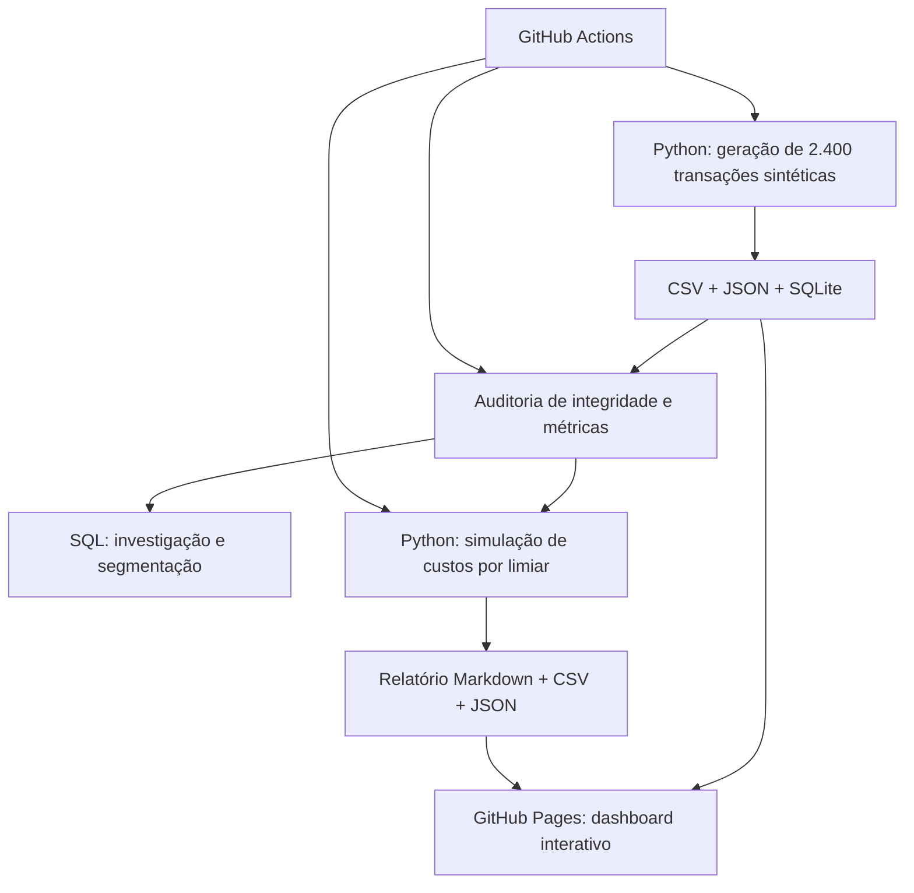

<div align="center">

# ATLAS | Fraud Intelligence

### Transaction Risk Observatory · Estudo de caso em Análise de Dados e Inteligência Antifraude

**Python · SQL (SQLite) · JavaScript · GitHub Actions · Data Visualization**

[**Explorar dashboard**](https://manoel-arthur.github.io/atlas-fraud-intelligence/) · [**Análise de custos**](ANALISE_CUSTO_OPERACIONAL.md) · [**Notebook exploratório**](notebooks/ATLAS_analise_exploratoria.ipynb) · [**Pipeline automatizado**](../../actions)

</div>

> [!IMPORTANT]
> **Projeto demonstrativo para portfólio.** As 2.400 transações, os rótulos de fraude e os custos são **sintéticos/hipotéticos**. O ATLAS não processa transações bancárias reais, não utiliza dados pessoais e não deve orientar decisões financeiras reais.

## Visão geral

O ATLAS simula uma operação de monitoramento transacional. O desafio de negócio é **priorizar transações potencialmente suspeitas**, equilibrando a capacidade de investigação da equipe com o risco de não detectar uma fraude.

O projeto transforma esse problema em um fluxo analítico reproduzível: geração de dados, armazenamento, investigação SQL, validação de métricas, simulação de custos e visualização interativa.

**Pergunta central:** *qual limiar de risco minimiza o custo operacional estimado, considerando o preço de investigar alertas e o custo de fraudes não detectadas?*

## Dashboard ao vivo

**[Abrir ATLAS — Fraud Intelligence](https://manoel-arthur.github.io/atlas-fraud-intelligence/)**

O dashboard inclui KPIs, evolução mensal, distribuição por estado, indicadores de classificação, filtros, investigação de transações, exportação CSV e **gráfico interativo de custo por limiar**.

### Prévia do projeto

> **Visualização:** o link acima abre o dashboard real e interativo. Uma captura de tela estática poderá ser adicionada aqui posteriormente; não foi incluída uma imagem não verificada.

## Arquitetura e fluxo de dados



| Camada | Tecnologia | Responsabilidade |
|---|---|---|
| Engenharia de dados | Python 3 | Geração determinística, score heurístico e exportações |
| Persistência | SQLite, CSV, JSON | Consulta analítica e intercâmbio de dados |
| Investigação | SQL | Matriz de classificação, evolução mensal, estados e sinais |
| Qualidade | Python + GitHub Actions | Conferência de registros, integridade e consistência dos KPIs |
| Simulação de negócio | Python | Custos, falsos positivos/negativos e escolha de limiar |
| Visualização | HTML, CSS, JavaScript | Dashboard responsivo publicado no GitHub Pages |

**Nota técnica:** o GitHub Pages serve arquivos estáticos; Python e SQLite são executados no pipeline, não no navegador ou em um backend de produção.

## Análise de negócio e resultados reproduzíveis

A análise compara **15 limiares**, de 20 a 90 pontos, com premissas hipotéticas de **R$ 12 por alerta investigado** e **R$ 900 por fraude não detectada**.

**Os resultados são recalculados automaticamente a cada geração de dados.** Consulte [`data/analise_custos.json`](data/analise_custos.json) para valores atuais, inclusive o limiar de menor custo. Não há garantia de que o limiar 45 continue sendo o melhor após a atualização do gerador.

A interpretação exige considerar capacidade da equipe, custos reais, qualidade dos rótulos e validação externa. Os valores são apenas demonstrações.

## Como a qualidade dos dados é verificada

O script [`scripts/audit_data.py`](scripts/audit_data.py) valida:

1. Consistência dos **2.400 registros** entre JSON, CSV e SQLite.
2. Ausência de identificadores duplicados e integridade do banco SQLite.
3. Equivalência entre contagens de classificação calculadas em Python e SQL para os limiares 40, 50, 60, 70 e 80.
4. Exportação dos indicadores auditados em [`data/auditoria_metricas.json`](data/auditoria_metricas.json).

A rotina é executada automaticamente no [GitHub Actions](../../actions). Uma falha interrompe o fluxo antes da publicação dos resultados.

## Estrutura do repositório

```text
atlas-fraud-intelligence/
├── index.html                         # Dashboard responsivo
├── scripts/
│   ├── build_data.py                  # Geração sintética e exportações
│   ├── audit_data.py                  # Auditoria de consistência
│   └── analyze_costs.py               # Avaliação econômica dos limiares
├── sql/
│   └── investigacao.sql               # Consultas analíticas SQLite
├── notebooks/
│   └── ATLAS_analise_exploratoria.ipynb
├── data/
│   ├── transacoes.csv
│   ├── transacoes.json
│   ├── atlas.sqlite
│   ├── auditoria_metricas.json
│   ├── analise_custos.csv
│   └── analise_custos.json
├── .github/workflows/
│   └── build-data.yml                 # Pipeline CI
└── ANALISE_CUSTO_OPERACIONAL.md       # Relatório de decisão
```

## Executar localmente

**Pré-requisito:** Python 3.10 ou superior. Os três scripts principais utilizam apenas a biblioteca padrão.

```bash
git clone https://github.com/manoel-arthur/atlas-fraud-intelligence.git
cd atlas-fraud-intelligence

python scripts/build_data.py
python scripts/audit_data.py
python scripts/analyze_costs.py

python -m http.server 8000
```

Abra **http://localhost:8000** no navegador. Para executar a investigação SQL, utilize um cliente SQLite ou:

```bash
sqlite3 data/atlas.sqlite < sql/investigacao.sql
```

O notebook exploratório requer `pandas`, `matplotlib` e um ambiente Jupyter. Ele pode ser aberto no GitHub e executado em um ambiente Python configurado com essas dependências.

## Metodologia e limitações

- **Geração determinística:** os registros usam semente fixa, perfis de clientes simulados, distribuição assimétrica de valores, sazonalidade e ruído para criar relações menos triviais. Não são amostras de uma população real.
- **Score heurístico:** o risco é calculado a partir de sinais simulados, como dispositivo novo, velocidade transacional, horário atípico e localização incomum.
- **Rótulos artificiais:** a variável de fraude é gerada probabilisticamente a partir de fatores observados e latentes, separadamente do score. Ainda assim, as associações foram definidas pelo gerador e não comprovam poder preditivo real.
- **Sem modelo treinado:** o projeto **não** utiliza machine learning supervisionado nem afirma desempenho em produção.
- **Custos ilustrativos:** os valores não incluem custos de bloqueio indevido, recuperação de perdas, capacidade operacional ou efeitos sobre clientes.
- **Sem validação externa:** resultados não são generalizáveis para transações reais.

## Possíveis evoluções

- Análise de sensibilidade das premissas financeiras e restrições de capacidade.
- Avaliação de fairness e estabilidade por segmentos.
- Testes com uma base pública devidamente documentada.
- Monitoramento de qualidade e documentação de decisões analíticas.

---

<div align="center">

**ATLAS | Fraud Intelligence** · Projeto de portfólio em análise de dados, BI e prevenção a fraudes.

[Dashboard](https://manoel-arthur.github.io/atlas-fraud-intelligence/) · [Código-fonte](https://github.com/manoel-arthur/atlas-fraud-intelligence) · [Relatório de custos](ANALISE_CUSTO_OPERACIONAL.md)

</div>
